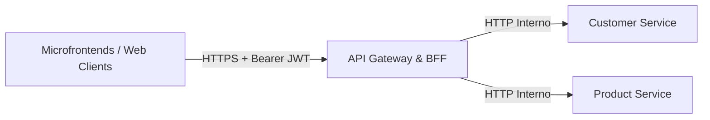
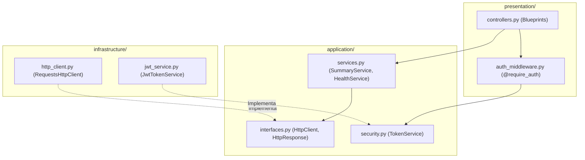
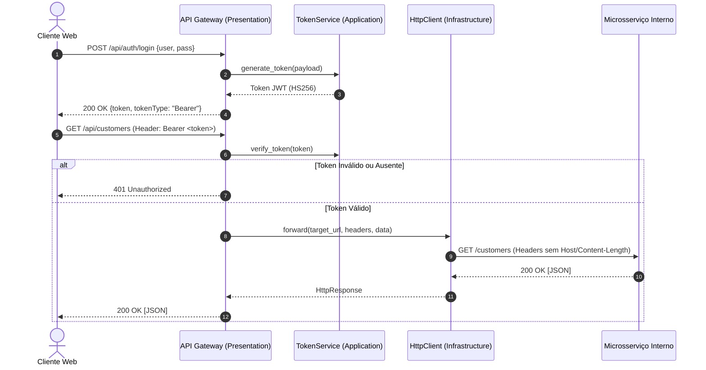

# Documentação Arquitetural Arc42 — API Gateway & BFF

---

## 1. Introdução e Metas

### 1.1 Objetivos de Negócio
O **API Gateway & Backend-For-Frontend (BFF)** atua como a porta de entrada única para todo o tráfego de frontend da plataforma **CRMaster**. Ele protege a infraestrutura interna de microsserviços, agrega múltiplas fontes de dados para otimizar o tempo de resposta em conexões de clientes e centraliza as políticas de segurança e autenticação baseadas em tokens JWT.

### 1.2 Metas de Qualidade
* **Resiliência e Disponibilidade:** Implementação de timeouts rigorosos (5.0s proxy, 3.0s BFF, 2.0s health check) e proteção contra serviços fora do ar (`503 Service Unavailable`, `504 Gateway Timeout`).
* **Segurança Centralizada:** Emissão e verificação de Bearer Tokens JWT no gateway, desonerando os microsserviços de negócio da validação de chaves criptográficas.
* **Agregação Eficiente (BFF):** Redução drástica de *chattiness* de rede através do endpoint `/api/summary`.

---

## 2. Restrições Arquiteturais

| Restrição | Descrição |
| :--- | :--- |
| **Linguagem & Framework** | Python 3.11+ e Flask / Gunicorn. |
| **Isolamento de Banco** | O Gateway tem **proibição estrita** de importar drivers de banco de dados (`sqlite3`, `sqlalchemy`, `pymongo`, `pyodbc`). |
| **Comunicação Backend** | Exclusivamente via chamadas síncronas HTTP REST em rede privada. |
| **Ambiente de Nuvem** | Azure App Service (Linux Web App). |

---

## 3. Contexto e Escopo

### 3.1 Contexto de Negócio

### 3.2 Tabela de Mapeamento de Rotas
* `/api/auth/login`: Emissão de tokens JWT.
* `/api/auth/verify`: Validação de tokens de sessão.
* `/api/summary`: Endpoint BFF que consolida contagens de clientes e produtos.
* `/api/health`: Health check agregado de todo o ecossistema.
* `/api/customers/*`: Proxy reverso para o `customer-service`.
* `/api/products/*`: Proxy reverso para o `product-service`.

---

## 4. Estratégia de Solução

* **Clean Architecture & SOLID:**
  * `application/`: Interfaces abstratas (`HttpClient`, `TokenService`) e serviços puros de agregação (`SummaryService`, `HealthService`).
  * `infrastructure/`: Implementação concreta do cliente HTTP com `requests` e do serviço JWT com `PyJWT`.
  * `presentation/`: Blueprint com rotas proxy e endpoints BFF, utilizando o decorator `@require_auth`.
  * `app.py`: Composition Root que injeta as implementações concretas nos serviços.

---

## 5. Visão dos Blocos de Construção

### Nível 1: Decomposição em Camadas

---

## 6. Visão de Execução

### Fluxo de Autenticação e Proxy Reverso com Validação JWT

---

## 7. Visão de Implantação

* **Azure App Service:** `formativa-api-gateway` rodando em contêiner ou stack Python 3.11 sob o servidor de aplicação Gunicorn (`gunicorn --workers 2 --threads 4 app:app`).
* **Variáveis de Ambiente Configuradas na Nuvem:**
  * `CUSTOMERS_SERVICE_URL`: URL interna do serviço de clientes.
  * `PRODUCTS_SERVICE_URL`: URL interna do serviço de produtos.
  * `JWT_SECRET_KEY`: Chave de assinatura criptográfica de 256 bits.
  * `JWT_ALGORITHM`: `HS256`.

---

## 8. Conceitos Transversais

* **Segurança Centralizada:** O gateway faz a terminação e validação dos tokens JWT, impedindo que requisições forjadas cheguem à rede dos microsserviços.
* **CORS Unificado:** Configurado via `flask_cors` para permitir requisições seguras com headers customizados vindas dos microfrontends.
* **Fitness Functions de Arquitetura:** Testes automáticos em `tests/test_gateway_architecture.py` garantem ausência total de imports de banco de dados ou referências diretas a microsserviços.

---

## 9. Decisões Arquiteturais (ADRs)

* **ADR-GW-01: Adoção do Padrão Backend-For-Frontend (BFF)**
  * *Contexto:* O frontend realizava múltiplas requisições sequenciais para montar a tela inicial.
  * *Decisão:* Criar endpoints agregados dedicados (`/api/summary`) no gateway.
* **ADR-GW-02: Isolamento Estrito de Banco de Dados**
  * *Contexto:* O gateway deve ter alta taxa de vazão e não pode manter estado ou conexões de persistência.
  * *Decisão:* Proibir via Fitness Functions qualquer dependência com ORM ou drivers de banco.

---

## 10. Requisitos de Qualidade (ATAM & ISO/IEC 25010)

| ID | Atributo | Cenário ATAM (6 Partes) |
| :--- | :--- | :--- |
| **QA-GW-01** | **Segurança** | **Fonte:** Atacante externo. **Estímulo:** Envia requisição com token JWT forjado. **Artefato:** Gateway / TokenService. **Ambiente:** Normal. **Resposta:** Rejeição imediata com código 401. **Medida:** Nenhuma requisição inválida é encaminhada. |
| **QA-GW-02** | **Tolerância a Falhas** | **Fonte:** Microsserviço downstream. **Estímulo:** Inicia timeout ou trava. **Artefato:** HttpClient. **Ambiente:** Sob carga. **Resposta:** Resposta com código 504 em até 5.0 segundos. **Medida:** O gateway não trava seus workers. |

---

## 11. Riscos e Dívidas Técnicas

* **Single Point of Failure (SPOF):** Como todo o tráfego passa pelo Gateway, uma falha indisponibiliza a aplicação. Mitigado através de auto-scaling e health checks no Azure App Service.
* **Revogação de Tokens JWT:** Tokens JWT são stateless. Uma futura dívida técnica é adicionar uma *blocklist* em memória rápida (Redis) para revogação imediata de tokens antes da expiração.

---

## 12. Glossário

* **BFF (Backend-For-Frontend):** Camada de orquestração focada em atender necessidades específicas do cliente de apresentação.
* **Reverse Proxy:** Servidor que recebe requisições de clientes e as despacha para servidores de backend internos.
* **Bearer Token:** Formato padrão de envio de credenciais de autenticação no cabeçalho HTTP `Authorization`.
