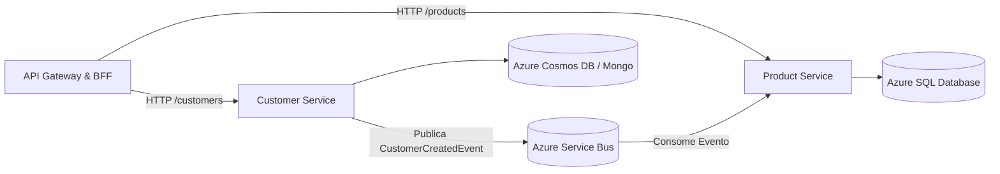
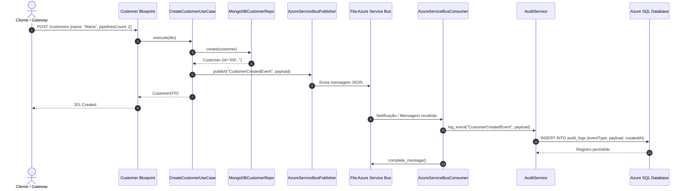

# Documentação Arquitetural Arc42 — Backend Microsserviços (Clean Architecture & SOLID)

---

## 1. Introdução e Metas

### 1.1 Objetivos de Negócio
O backend da plataforma **CRMaster** provê a persistência e o processamento de regras de negócio fundamentais nos domínios de clientes (`customer-service`) e catálogo comercial de produtos (`product-service`). A arquitetura adota o padrão **Database-per-Service** com tecnologias heterogêneas (NoSQL e Relacional) e mensageria assíncrona orientada a eventos através do **Azure Service Bus**.

### 1.2 Metas de Qualidade
* **Desacoplamento e Clean Architecture:** Regras de negócio puras em entidades e casos de uso, sem dependência direta de frameworks de persistência ou HTTP.
* **Consistência Eventual:** Integração assíncrona tolerante a falhas entre serviços utilizando mensageria corporativa.
* **Escalabilidade Independente:** Microsserviços autônomos com ciclos de vida e bancos de dados isolados.

---

## 2. Restrições Arquiteturais

| Restrição | Descrição |
| :--- | :--- |
| **Linguagem & Framework** | Python 3.11+ com Flask e Gunicorn. |
| **Persistência de Clientes** | MongoDB / Azure Cosmos DB (API MongoDB) com driver `pymongo`. |
| **Persistência de Produtos** | Azure SQL Database / SQL Server com driver `pyodbc` / SQLAlchemy. |
| **Mensageria Assíncrona** | Azure Service Bus (com fila `customer-events`). |
| **Regra de Dependência** | `domain` não depende de nada externo; `application` depende apenas de interfaces abstratas; `infrastructure` provê os adaptadores. |

---

## 3. Contexto e Escopo

### 3.1 Contexto de Negócio



---

## 4. Estratégia de Solução

* **Clean Architecture em cada Microsserviço:**
  * `domain/`: Entidades puras (`Customer`, `Product`) com invariantes de negócio e validações, sem imports externos.
  * `application/`: Casos de uso (`CreateCustomerUseCase`, `ListProductsUseCase`), DTOs e interfaces abstratas de repositório (`CustomerRepository`, `ProductRepository`) e mensageria (`EventPublisher`, `EventConsumer`).
  * `infrastructure/`: Adaptadores concretos (`MongoDBCustomerRepository`, `SQLAlchemyProductRepository`, `AzureServiceBusEventPublisher`, `AzureServiceBusEventConsumer`).
  * `presentation/`: Blueprints Flask sem SQL ou lógica de domínio.
  * `app.py`: Composition Root para injeção de dependências.
* **Database-per-Service:**
  * O `customer-service` persiste em documentos BSON (MongoDB) tratando `_id` para `id` de forma transparente.
  * O `product-service` persiste produtos e logs de auditoria no Azure SQL Database com preços inteiros em centavos para prevenir erros de arredondamento financeiro.

---

## 5. Visão dos Blocos de Construção

### Nível 1: Estrutura em Camadas dos Microsserviços

```mermaid
graph TD
    subgraph PresentationLayer [presentation/]
        Controllers[controllers.py (Flask Blueprints)]
    end
    subgraph ApplicationLayer [application/]
        UseCases[use_cases.py (Casos de Uso)]
        DTOs[dtos.py (DTOs de Entrada e Saída)]
        RepoInterfaces[repositories.py (Interfaces Abstratas ABC)]
        EventInterfaces[events.py (EventPublisher / EventConsumer)]
    end
    subgraph DomainLayer [domain/]
        Entities[entities.py (Entidades Puras Customer, Product)]
        Exceptions[exceptions.py (Domain Exceptions)]
    end
    subgraph InfrastructureLayer [infrastructure/]
        MongoRepo[mongo_repository.py / MongoDBCustomerRepository]
        SQLRepo[repositories.py / SQLAlchemyProductRepository]
        BusPublisher[event_publisher.py / AzureServiceBusEventPublisher]
        BusConsumer[event_consumer.py / AzureServiceBusEventConsumer]
    end

    Controllers --> UseCases
    UseCases --> Entities
    UseCases --> RepoInterfaces
    UseCases --> EventInterfaces
    MongoRepo -.->|Implementa| RepoInterfaces
    SQLRepo -.->|Implementa| RepoInterfaces
    BusPublisher -.->|Implementa| EventInterfaces
    BusConsumer -.->|Implementa| EventInterfaces
```

---

## 6. Visão de Execução

### Fluxo Assíncrono Orientado a Eventos (Azure Service Bus)



---

## 7. Visão de Implantação

* **Azure App Service:** Instâncias dedicadas `formativa-customer-service` e `formativa-product-service`.
* **Azure Cosmos DB (API MongoDB):** Banco NoSQL elástico para clientes (`customers_db`).
* **Azure SQL Database:** Banco de dados transacional relacional para catálogo e logs de auditoria.
* **Azure Service Bus:** Namespace corporativo com fila provisionada `customer-events`.

---

## 8. Conceitos Transversais

* **Princípio da Responsabilidade Única (SRP):** Casos de uso possuem apenas uma única ação orquestrada.
* **Inversão de Dependência (DIP):** Módulos de alto nível (`application`) dependem exclusivamente de abstrações (`ABC`).
* **Fitness Functions de Arquitetura:** Testes rigorosos com `pytest` e `pytest-archon` garantem que não há invasão de escopo entre camadas nem vazamento de modelos entre os microsserviços.

---

## 9. Decisões Arquiteturais (ADRs)

* **ADR-BE-01: Adoção do Padrão Database-per-Service**
  * *Contexto:* Evitar acoplamento de schema e contenção de banco compartilhado.
  * *Decisão:* MongoDB para clientes (documentos flexíveis) e Azure SQL para produtos e auditoria.
* **ADR-BE-02: Integração Assíncrona via Azure Service Bus**
  * *Contexto:* Operações entre clientes e outros módulos não devem bloquear a resposta HTTP.
  * *Decisão:* Publicação de eventos de domínio em fila gerenciada em nuvem.
* **ADR-BE-03: Preços Armazenados em Centavos (Inteiros)**
  * *Contexto:* Erros de arredondamento de ponto flutuante em valores monetários.
  * *Decisão:* Representar o campo `price` como inteiro (centavos de Real).

---

## 10. Requisitos de Qualidade (ATAM & ISO/IEC 25010)

| ID | Atributo | Cenário ATAM (6 Partes) |
| :--- | :--- | :--- |
| **QA-BE-01** | **Integridade de Dados** | **Fonte:** Usuário. **Estímulo:** Cria cliente. **Artefato:** MongoDB Repo. **Ambiente:** Normal. **Resposta:** Persistência no Cosmos DB e emissão de evento no Service Bus. **Medida:** Transação e evento despachados com sucesso. |
| **QA-BE-02** | **Testabilidade & Desacoplamento** | **Fonte:** Engenheiro QA. **Estímulo:** Executa testes unitários sem banco. **Artefato:** Casos de uso. **Ambiente:** CI/CD. **Resposta:** Execução completa em < 1 segundo via mocks. **Medida:** 100% dos testes unitários passam sem infraestrutura externa. |

---

## 11. Riscos e Dívidas Técnicas

* **Transação Distribuída (Dual-Write):** Em caso de queda imediatamente após a escrita no banco e antes da publicação no Service Bus, pode ocorrer inconsistência. Mitigação futura: padrão *Transactional Outbox*.
* **Dead-Letter Queue:** Mensagens com erro repetido no Service Bus devem ser encaminhadas para fila morta (DLQ) com alarmes.

---

## 12. Glossário

* **Composition Root:** Ponto de entrada da aplicação (`app.py`) onde as implementações concretas são injetadas.
* **DTO (Data Transfer Object):** Objeto imutável de transporte de dados entre camadas.
* **EventPublisher / EventConsumer:** Interfaces abstratas para mensageria assíncrona.
